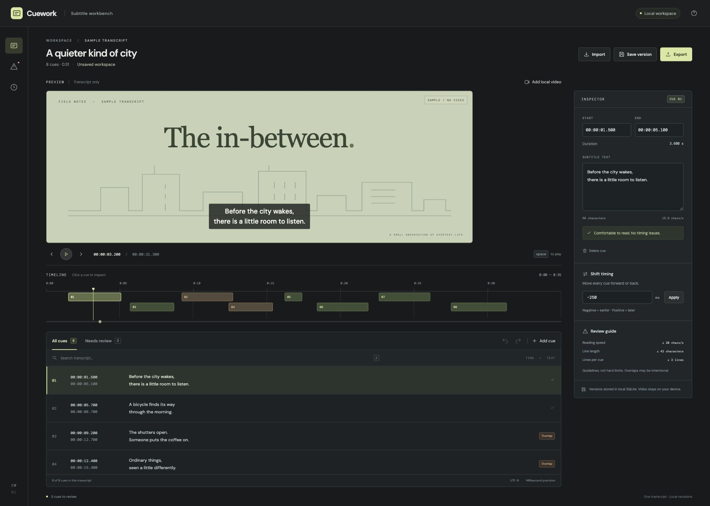

# Cuework

[Open the browser workspace](https://miiduoa.github.io/cuework/) · [繁體中文](docs/README.zh-TW.md) · [Verification](docs/verification.md)

A subtitle timing workbench for the last pass before delivery. Import a transcript, find overlapping or hard-to-read cues, adjust timing, and export SRT or WebVTT.



## Use it locally

Requires **Node.js 24 or later**.

```sh
npm ci
npm run build
npm start
```

Open **http://127.0.0.1:4173**. Versions are stored in `.data/cuework.sqlite`. Set `PORT` or `CUEWORK_DATA_DIR` to change the port or storage directory. The server binds only to loopback.

## What it does

- Import complete SRT and WebVTT files; a malformed or unsupported block rejects the whole import.
- Edit cue text and millisecond timestamps, search the transcript, and move between cues on the timeline.
- Review nested overlaps, invalid timing, reading speed, and line length. Readability warnings are guidance; invalid cues block export.
- Shift every cue by a signed millisecond offset. An offset outside the supported range rejects the entire operation.
- Attach a local video for timing checks. Video uses an object URL, is never uploaded, and is not included in saved versions.
- Save immutable versions and restore any of the latest 50 as a new version. Concurrent edits cannot silently overwrite a newer saved version.
- Export sorted SRT or WebVTT, preserving text and millisecond precision. Undo and redo cover editing changes.

The opening transcript is a fictional sample with intentional overlap and readability warnings. No video file is bundled; its illustrated frame is a transcript-only placeholder.

## Two storage modes

| Command                       | Interface                        | Storage                               |
| ----------------------------- | -------------------------------- | ------------------------------------- |
| `npm run build` + `npm start` | Local workspace                  | SQLite through the local Node API     |
| `npm run dev`                 | Browser workspace                | IndexedDB in this browser and origin  |
| `npm run build:pages`         | Browser workspace at `/cuework/` | IndexedDB; no backend on GitHub Pages |

Browser storage is device- and origin-specific. Clearing site data removes its saved versions. Export copies you need to keep. Neither mode provides accounts, cloud sync, automatic saving, or collaboration. Each workspace holds one current transcript and its revision history.

For frontend development against the SQLite API, keep `npm start` running and use `npm run dev -- --mode workspace` in another terminal. The dev proxy forwards same-origin API requests to port 4173.

## Boundaries

Imports are limited to 1 MiB, 1,000 cues, and 4,000 characters per cue. Timings range from `00:00:00.000` to `99:59:59.999`. Text must be non-empty and contain no blank separator lines or timing arrows to export.

WebVTT identifiers and positioning settings survive VTT export. SRT export uses sequential cue numbers and omits VTT positioning. Notes, styles, regions, header metadata, and inline timestamp tags are explicitly rejected. Subtitle markup stays in the text; the preview displays it literally, without interpreting HTML or WebVTT styling. Video playback depends on the browser's codec support.

The local API checks Host, Origin, content type, payload size, and document shape. It is designed as a single-user loopback tool, not a public service. Do not put it behind a public proxy or expose the port to other machines. `.data/` and local video files are excluded from Git.

## Development

```sh
npm run dev       # browser workspace on port 5173
npm run check     # strict TypeScript check
npm test          # parser, timing, SQLite, HTTP and IndexedDB tests
npm run build    # production client for the local server
npm run build:pages
```

The test suite covers subtitle round trips, nested overlaps, atomic offsets, malformed input, file limits, restart persistence, competing SQLite and IndexedDB writers, restore history, and HTTP Host/Origin rejection. GitHub Actions runs checks and both builds on Node 24 and 26. The Pages workflow builds browser mode before deployment.

`src/core.ts` contains the shared subtitle rules. `src/persistence.ts` provides interchangeable API and IndexedDB adapters. `server/store.ts` commits revisions inside `BEGIN IMMEDIATE` transactions, checking the client's expected revision before insertion. The HTTP API returns `409` for stale saves; the editor keeps the draft available to export.

| Endpoint                       | Purpose                               |
| ------------------------------ | ------------------------------------- |
| `GET /api/document`            | Latest saved snapshot, or `null`      |
| `PUT /api/document`            | Save `{ document, expectedRevision }` |
| `GET /api/revisions`           | Latest 50 revision summaries          |
| `GET /api/revisions/:revision` | Read an immutable snapshot            |

Restoring reads an old snapshot and submits it as a new save against the current revision. There is no overwrite or delete endpoint.

## License

MIT. DM Sans and DM Mono are bundled under the SIL Open Font License; their notices are in `src/assets/`.
